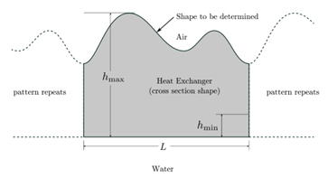

# Heat Exchanger Shape Optimization

MATLAB implementation of a constrained shape-optimization problem for a heat exchanger cross section. The geometry is defined by a truncated Fourier sine series, and a two-dimensional steady-state conduction calculation supplies the heat-transfer objective. The optimization searches for a profile that increases heat transfer while maintaining prescribed minimum and maximum section heights.

## Problem setup

A solid section conducts heat between prescribed water-side and air-side temperatures. Its lower boundary is straight and its upper boundary is represented by a variable-height profile. The left and right boundaries are periodic.

| Parameter | Value |
|---|---|
| Section length | 0.05 m |
| Thermal conductivity | 20 W/(m·K) |
| Water-side temperature | 90 °C |
| Air-side temperature | 20 °C |
| Minimum height | 0.01 m |
| Maximum height | 0.05 m |
| Fourier design variables | 10 |
| Main optimization mesh | 800 × 800 cells |

## Method

The height profile is defined as

$$
h(x)=a_1+\sum_{j=2}^{m}a_j\sin\left(\frac{2\pi(j-1)x}{L}\right),
$$

where $L$ is section length, $m=10$ is the number of design variables, and $a_j$ are the optimized Fourier coefficients.

Height is constrained at the sampled mesh positions:

$$
0.01\,\mathrm{m}\leq h(x_i)\leq0.05\,\mathrm{m}.
$$

The numerical calculation evaluates conductive heat transfer per unit out-of-plane depth, $Q'$, in W/m. The objective passed to MATLAB's `fmincon` is the reciprocal:

$$
J(\mathbf a)=\frac{1}{Q'(\mathbf a)}.
$$

For positive $Q'$, minimizing $J$ is equivalent to maximizing the calculated heat transfer. The main optimization specifies the sequential quadratic programming (SQP) algorithm.

## Repository files

| File | Purpose |
|---|---|
| [`run_opt.m`](run_opt.m) | Defines parameters and geometric constraints, runs the optimization, plots the geometry, and specifies the mesh study |
| [`objective.m`](objective.m) | Evaluates reciprocal heat transfer for a candidate geometry |
| [`CalcFlux.m`](CalcFlux.m) | Solves the conduction problem and calculates heat transfer through the bottom boundary |
| [`BuildMesh.m`](BuildMesh.m) | Generates the two-dimensional quadrilateral mesh |
| [`BuildSystem.m`](BuildSystem.m) | Assembles the sparse numerical conduction system |

## Results

### Mesh convergence

![][mesh_convergence]

The provided results show decreasing sensitivity of the calculated heat transfer to mesh refinement at higher resolutions. The mesh study reaches 1,000 divisions along each coordinate direction; the main optimization is configured with 800.

### Optimization convergence

![][optimization_convergence]

The supplied solver figure shows a rapid reduction in feasibility and first-order optimality.

### Geometry comparison

![][optimized_geometry]

The optimized profile remains close to its initial shape. The provided figures and article do not give initial and optimized heat-transfer values from which to calculate a percentage improvement.

## Modeling scope

The calculation treats conduction through a solid with fixed temperatures at the upper and lower boundaries. It does not model fluid flow, convective heat-transfer coefficients, pressure drop, or temperature-dependent material properties. The optimized result is a constrained local solution for this idealized model, not a complete heat exchanger performance prediction.

[mesh_convergence]: Flux.png
[optimization_convergence]: Feasibility.png
[optimized_geometry]: Height.png
